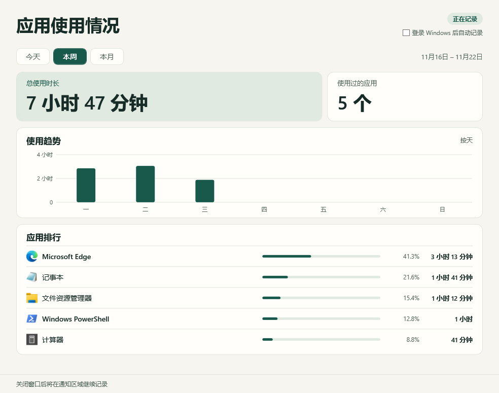

# 应用使用情况

在 Windows 上查看今天、本周和本月的前台应用使用时长，包括总时长、趋势和应用排行。

*图中为示例数据。*

在 [GitHub Releases](../../releases/latest) 下载 `WindowsAppUsage.exe`，双击即可运行。

## 使用方法

1. 双击下载的程序开始记录。程序可直接运行，无需安装或管理员权限。
2. 在主窗口切换「今天」「本周」「本月」。本周按周一至周日统计，本月按自然月统计。
3. 关闭窗口后，程序会继续在任务栏通知区域记录。双击托盘图标重新打开，或右键选择「退出并停止记录」。

可以勾选「登录 Windows 后自动记录」，下次登录时直接在托盘运行。启用后请将程序保存在固定位置。直接替换 EXE 可以升级，请先通过托盘菜单退出，已有记录会保留。

## 统计范围与隐私

- 时长从首次运行开始估算，只统计前台应用。锁屏、休眠、键鼠连续 2 分钟无操作后的时间以及查看本程序的时间不计入。
- 排行显示可获取的应用图标。旧记录若暂时缺少图标，会显示通用图标，可在再次使用对应应用时补齐。
- 应用标识、名称和按小时汇总的时长保存在本机的 `%LOCALAPPDATA%\AppUsage`。同目录缓存可获取的应用图标。程序无需联网，不记录窗口标题、网址或键盘输入内容。

使用记录保存在 `usage.tsv`，上一份记录保存在 `usage.tsv.bak`。主文件损坏时，程序会尝试从有效的备份恢复，并在写回时保留备份和损坏的主文件副本。暂时无法读取或保存时，程序会在界面和通知区域提示，保留内存中的新增记录并定期重试。

## 从源码构建

在项目目录运行以下命令。构建使用 Windows 自带的 .NET Framework C# 编译器，无需安装额外的 SDK 或依赖。

    powershell -NoProfile -ExecutionPolicy Bypass -File .\build.ps1

生成的 `软件使用情况.exe` 位于项目目录。

运行日志恢复、计时和显示格式测试：

    powershell -NoProfile -ExecutionPolicy Bypass -File .\build.ps1 -Test

测试使用独立的临时目录。

本项目使用 Codex 辅助开发。
